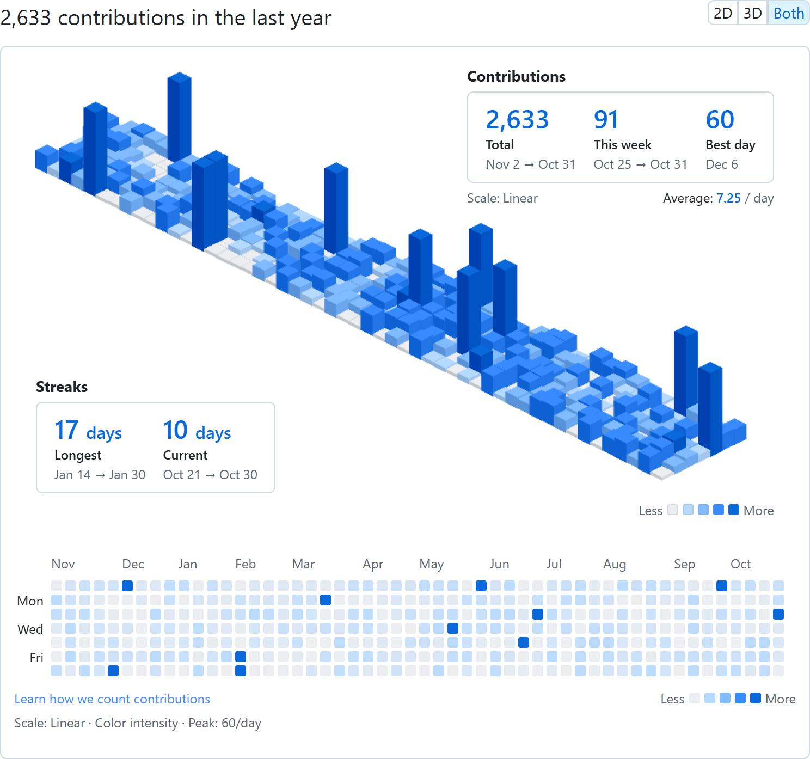
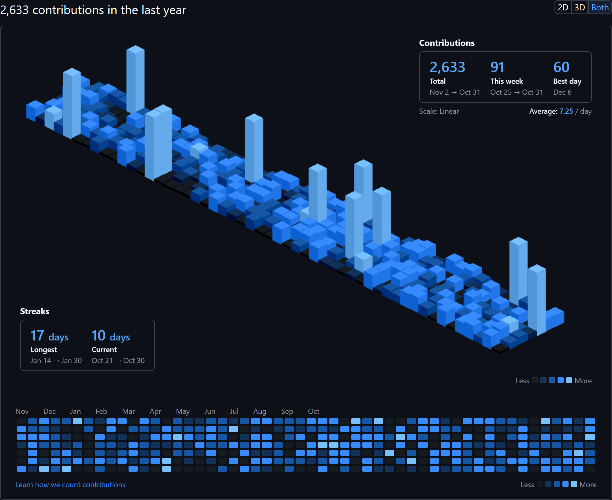
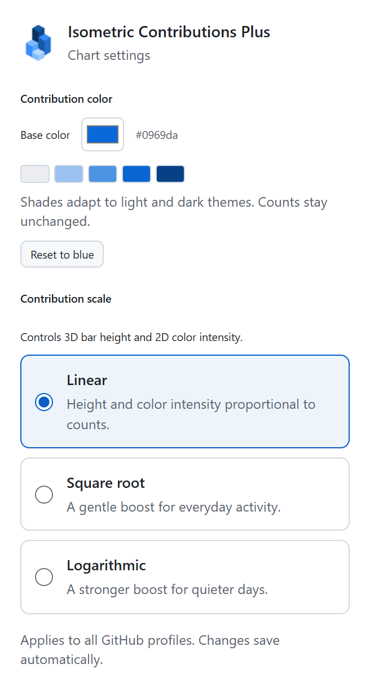
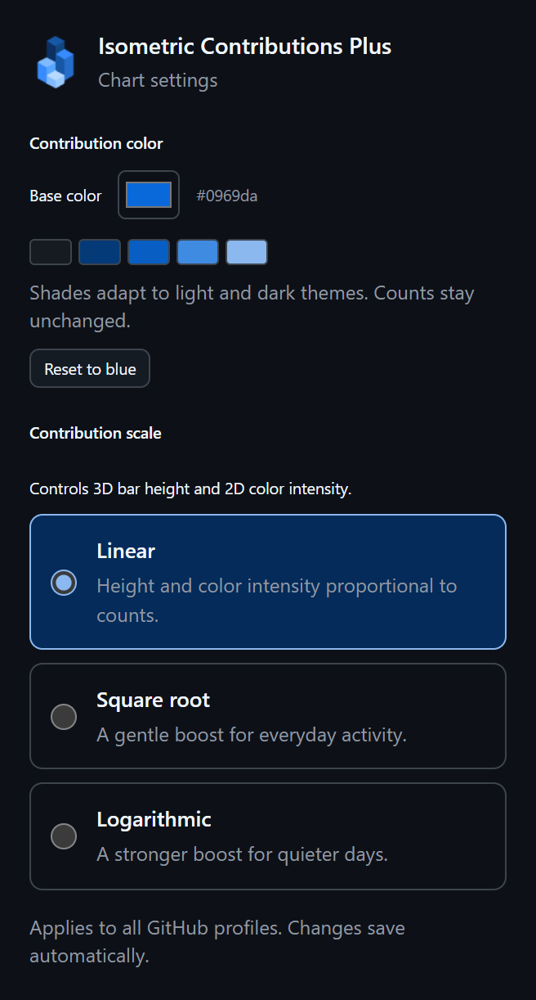
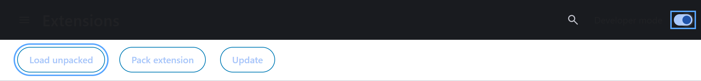
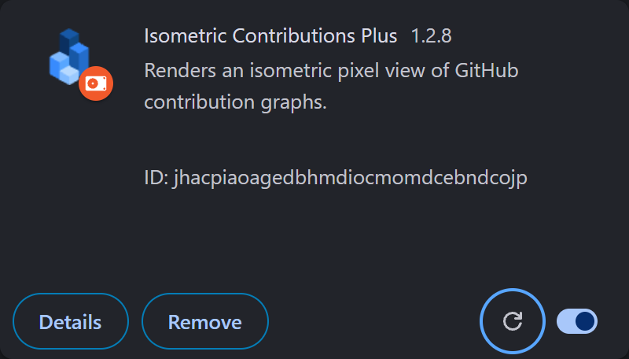

# Isometric Contributions Plus

[英文版](README.md) | 中文版

[](https://github.com/vycdev/isometric-contributions-plus/actions/workflows/nodejs.yml) [](LICENSE) [](https://www.patreon.com/cw/vycdev)

这是 [vycdev 维护的独立分支](https://github.com/vycdev/isometric-contributions-plus)，基于 [Jason Long 的 Isometric Contributions](https://github.com/jasonlong/isometric-contributions)。本扩展支持 Chrome / Brave、Firefox 和 Edge，并包含 Safari 项目，让你能够在 GitHub 用户档案页面的贡献图处，切换显示原生 2D 图与立体像素版贡献图。我们使用了 [obelisk.js](https://github.com/nosir/obelisk.js) 用于绘制立体图像。

默认蓝色主题覆盖日历、立体图、图例、统计与设置。无活动的日期保持中性色。图表配色跟随 GitHub 的外观设置，工具栏菜单跟随系统外观。以下截图使用示例数据。





立体图可以展示贡献数量之间的细微差异，但也有局限：没有坐标轴标签，较高的柱子可能遮挡较矮的柱子，且无法悬停查看日期和数量。需要这些信息时，可切换到 2D 或同时显示两种视图。

## 贡献缩放

点击扩展的工具栏图标，在 Contribution scale 中选择 3D 柱高与 2D 颜色强度的缩放方式：

- **Linear（线性，默认）**：柱高与颜色强度均与每日贡献数量成正比。
- **Square root（平方根）**：适度提升日常活动的可见度，同时保留峰值差异。
- **Logarithmic（对数）**：进一步降低异常峰值的视觉影响，使较少的日常活动更容易辨识。

设置会自动保存，跨个人主页、年份和页面刷新生效，并立即更新 2D、3D 与同时显示模式。当前缩放方式显示在每日平均值旁边与 2D 图例下方。缩放改变 3D 柱高与 2D 颜色强度；日历方块尺寸、日期、贡献数量、提示信息与统计数据保持不变。无活动的日期保持中性色，最繁忙的可见日期达到最大强度。




## 安装方式

**Plus 尚无经过确认的 Chrome、Firefox、Edge 或 Safari 商店页面。** 原扩展的商店页面不会安装本分支。请先从源码构建；后续发布包将出现在[本仓库的 Releases 页面](https://github.com/vycdev/isometric-contributions-plus/releases)。

安装 Node.js 22 或 24 及 pnpm 10.34.9 后运行（启用方式见 [Contributing](README.md#contributing)）：

```sh
git clone https://github.com/vycdev/isometric-contributions-plus.git
cd isometric-contributions-plus
pnpm install --frozen-lockfile
pnpm run build
```

- **Chrome / Brave / Edge：** 打开 `chrome://extensions`、`brave://extensions` 或 `edge://extensions`，开启开发者模式，选择“加载已解压的扩展程序”，并选中 `dist/` 目录。
- **Firefox：** 运行 `pnpm run build:firefox`，打开 `about:debugging#/runtime/this-firefox`，选择“临时载入附加组件”，并选中 `dist/manifest.json`。重启后临时安装会消失。打包使用本地 `web-ext` 工具，无需系统 `zip` 命令。
- **Safari：** 运行 `pnpm run build:safari --resources-only` 生成资源；原生应用构建需要 macOS 与 Xcode。签名配置见 [PUBLISHING.md](PUBLISHING.md#safari)（英文）。

请加载构建后的 `dist/`，因为 `src/` 中的模块需要 Parcel 编译。重新构建后请重新加载扩展。本分支目前仅在 `github.com` 上运行；工具栏弹窗用于贡献比例设置，不包含旧文档中的 Enterprise 域名启用菜单。

## 贡献

请在[本仓库的 issues](https://github.com/vycdev/isometric-contributions-plus/issues) 报告错误、咨询或讨论改进。开发时运行 `pnpm run start`；单元测试运行 `pnpm run test:unit`；格式、静态检查与单元测试运行 `pnpm test`。

商店账号和私人举报联系方式仍待维护者配置，详见 [PUBLISHING.md](PUBLISHING.md)。公开 issue 中请勿包含私人信息或敏感证据，也不要把本分支的支持或行为准则举报发送给原项目维护者。




共享配色位于 [`src/theme.css`](src/theme.css)。图标、截图的生成方法以及与颜色自定义、2D 缩放的集成约定，见 [`scripts/artwork/README.md`](scripts/artwork/README.md)。

## 相关项目

[Qiuner 的同名独立分支](https://github.com/Qiuner/isometric-contributions-plus) 包含 GitCode 集成等功能，与本仓库分别维护。

## 开源协议

本项目以 [MIT License](LICENSE) 协议开源，保留原始版权声明及第三方依赖许可。
