# Isometric Contributions Plus

[英文版](README.md) | 中文版

[](https://github.com/vycdev/isometric-contributions-plus/actions/workflows/nodejs.yml) [](LICENSE) [](https://www.patreon.com/cw/vycdev)

这是 [vycdev 维护的独立分支](https://github.com/vycdev/isometric-contributions-plus)，基于 [Jason Long 的 Isometric Contributions](https://github.com/jasonlong/isometric-contributions)。本扩展支持 Chrome / Brave、Firefox 和 Edge，并包含 Safari 项目，让你能够在 GitHub 用户档案页面的贡献图处，以任意组合显示立体像素图、折线趋势与原生 2D 日历。我们使用了 [obelisk.js](https://github.com/nosir/obelisk.js) 用于绘制立体图像。

默认蓝色主题覆盖日历、立体图、图例、统计与设置。无活动的日期保持中性色。图表配色跟随 GitHub 的外观设置，工具栏菜单跟随系统外观。以下截图使用示例数据。

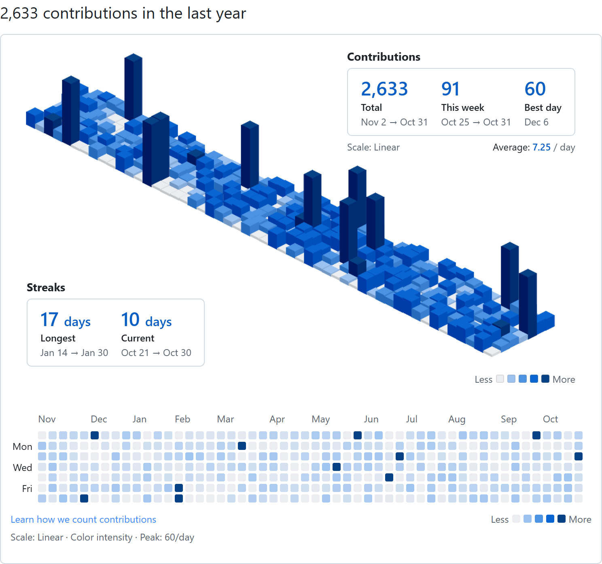

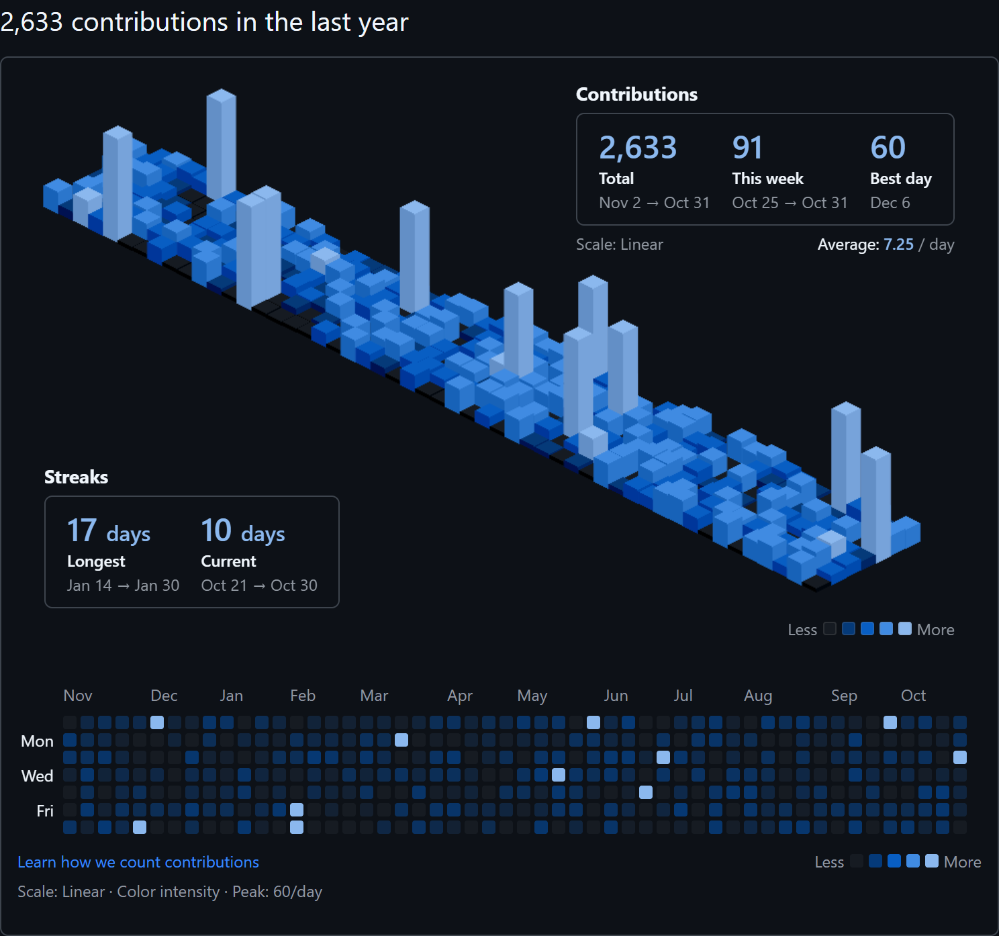

立体图可以展示贡献数量之间的细微差异，但也有局限：没有坐标轴标签，较高的柱子可能遮挡较矮的柱子，且无法悬停查看日期和数量。需要这些信息时，可在工具栏菜单中同时开启折线趋势或 2D 日历。

## 视图

点击扩展的工具栏图标，在 **Views** 中任意组合开启：

- **3D isometric（立体图，默认）**：立体方块，附总数、最佳单日与连续贡献天数。
- **Line trend（折线趋势）**：每日贡献的 28 天平均值，并以虚线显示前一年同期。
- **2D calendar（2D 日历）**：GitHub 原生日历，按所选缩放方式着色。

至少保留一个视图。设置会自动保存，已打开的个人主页会立即更新。

### 折线趋势

折线图回答日历难以回答的问题：你的活跃度在上升还是下降？比一年前更活跃吗？

- **Activity**：在淡色每日柱状图上显示 28 天平均值，并标出期间的最佳单日与最长连续贡献。
- **Cumulative**：显示累计总数与前一年同期的对比。
- 悬停图表，或聚焦后使用方向键，可查看任意一天的贡献数、平均值与前一年同期数值。
- 图表下方显示最近 30 天与之前 30 天的对比、本期总数与前一年的对比，以及最活跃的星期。

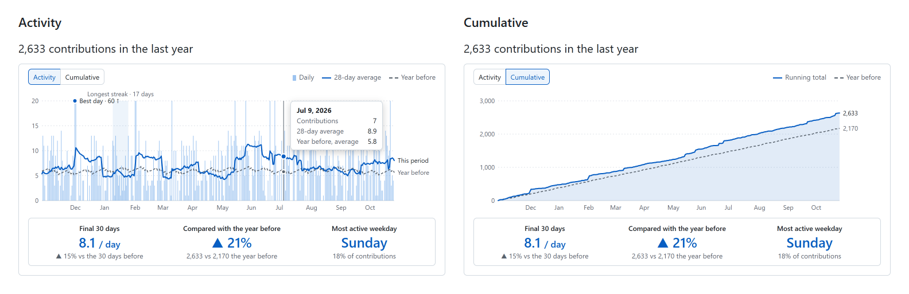

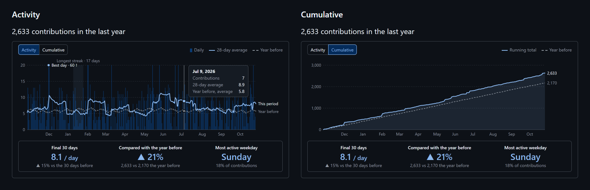

对比数据向前平移 52 周，使星期对齐。仅在开启折线视图时才会向 GitHub 请求前一年的数据；无法加载时，图表仍会显示你自己的趋势。

### 过去一年

在 GitHub 的年份列表中选择某一年后，GitHub 没有提供返回默认“过去 12 个月”视图的方式。扩展会在列表顶部添加 **Past year** 选项，点击即可返回。

## 贡献缩放

点击扩展的工具栏图标，在 Contribution scale 中选择 3D 柱高与 2D 颜色强度的缩放方式：

- **Linear（线性，默认）**：柱高与颜色强度均与每日贡献数量成正比。
- **Square root（平方根）**：适度提升日常活动的可见度，同时保留峰值差异。
- **Logarithmic（对数）**：进一步降低异常峰值的视觉影响，使较少的日常活动更容易辨识。

设置会自动保存，跨个人主页、年份和页面刷新生效，并立即更新所有视图。当前缩放方式显示在每日平均值旁边与 2D 图例下方。缩放改变 3D 柱高与 2D 颜色强度；日历方块尺寸、日期、贡献数量、提示信息与统计数据保持不变。无活动的日期保持中性色，最繁忙的可见日期达到最大强度。

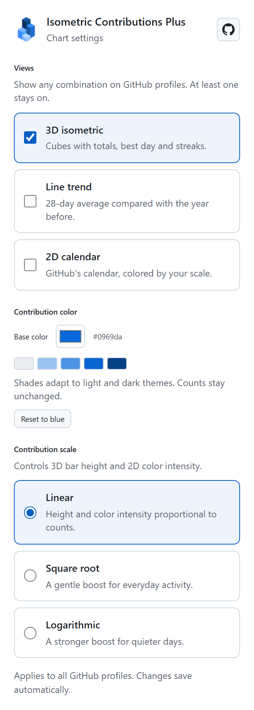
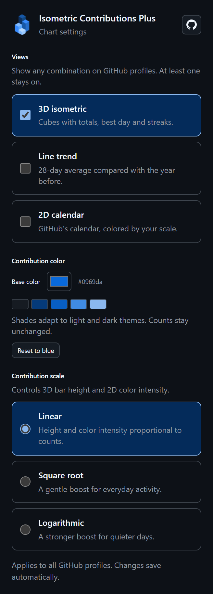

## 贡献颜色

在扩展的工具栏菜单中选择 **Contribution color**（贡献颜色）。扩展会根据所选颜色为浅色和深色主题生成易读的强度色阶；日历及其图例、3D 方块、统计数据和视图切换按钮会一起更新。**Reset to blue** 可恢复默认蓝色（`#0969da`），不会改变缩放设置。颜色只影响显示效果，贡献数量、日期、提示信息与统计数据保持不变。

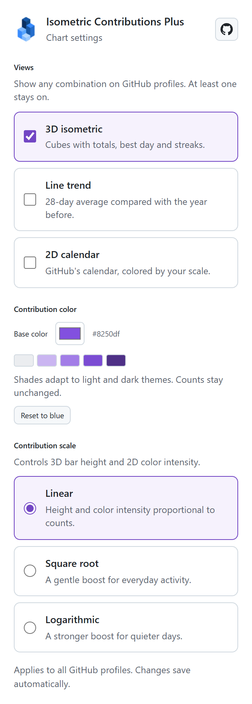
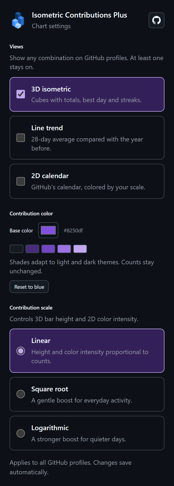

同一份示例数据分别使用绿色（`#1a7f37`）、紫色（`#8250df`）和橙色（`#e16f24`）的效果：

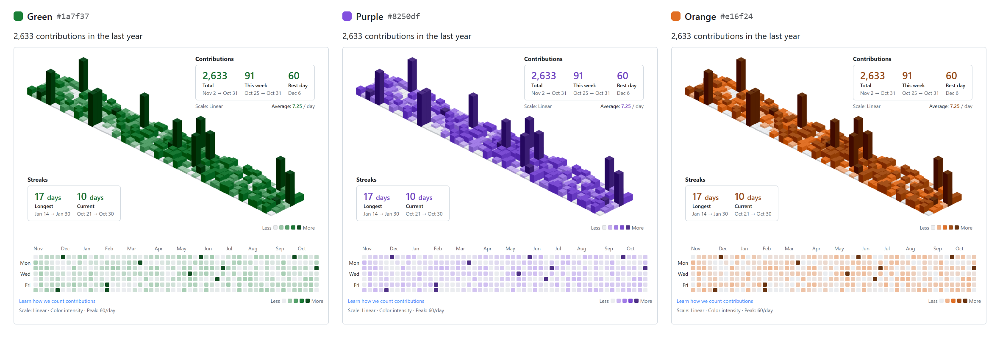

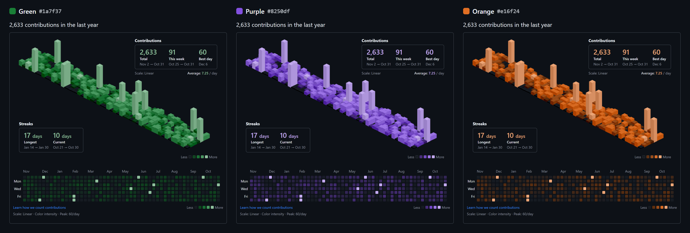

## 安装方式

**Plus 尚无经过确认的 Chrome、Firefox、Edge 或 Safari 商店页面。** 原扩展的商店页面不会安装本分支。请先从源码构建；后续发布包将出现在[本仓库的 Releases 页面](https://github.com/vycdev/isometric-contributions-plus/releases)。

安装 Node.js 22 或 24 及 pnpm 10.34.9 后运行（启用方式见 [Contributing](README.md#contributing)）：

```sh
git clone https://github.com/vycdev/isometric-contributions-plus.git
cd isometric-contributions-plus
pnpm install --frozen-lockfile
pnpm run build
```

- **Chrome / Brave / Edge：** 打开 `chrome://extensions`、`brave://extensions` 或 `edge://extensions`，开启开发者模式，选择“加载已解压的扩展程序”，并选中 `dist/` 目录。

  <picture>
    <source media="(prefers-color-scheme: dark)" srcset="img/dev-mode-dark.png" />
    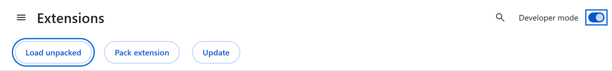
  </picture>

- **Firefox：** 运行 `pnpm run build:firefox`，打开 `about:debugging#/runtime/this-firefox`，选择“临时载入附加组件”，并选中 `dist/manifest.json`。重启后临时安装会消失。打包使用本地 `web-ext` 工具，无需系统 `zip` 命令。
- **Safari：** 运行 `pnpm run build:safari --resources-only` 生成资源；原生应用构建需要 macOS 与 Xcode。签名配置见 [PUBLISHING.md](PUBLISHING.md#safari)（英文）。

请加载构建后的 `dist/`，因为 `src/` 中的模块需要 Parcel 编译。重新构建后请重新加载扩展。本分支目前仅在 `github.com` 上运行；工具栏弹窗用于贡献比例设置，不包含旧文档中的 Enterprise 域名启用菜单。

## 贡献

请在[本仓库的 issues](https://github.com/vycdev/isometric-contributions-plus/issues) 报告错误、咨询或讨论改进。开发时运行 `pnpm run start`；单元测试运行 `pnpm run test:unit`；格式、静态检查与单元测试运行 `pnpm test`。

安全问题请按 [SECURITY.md](SECURITY.md)（英文）私下报告；行为准则或隐私相关的私人举报请发送邮件至 vycdev@gmail.com。商店账号仍待维护者配置，详见 [PUBLISHING.md](PUBLISHING.md)。公开 issue 中请勿包含私人信息或敏感证据，也不要把本分支的支持或行为准则举报发送给原项目维护者。

修改后请重新构建，然后在扩展卡片上点击重新加载按钮，并刷新已打开的 GitHub 页面。

<picture>
  <source media="(prefers-color-scheme: dark)" srcset="img/reload-link-dark.png" />
  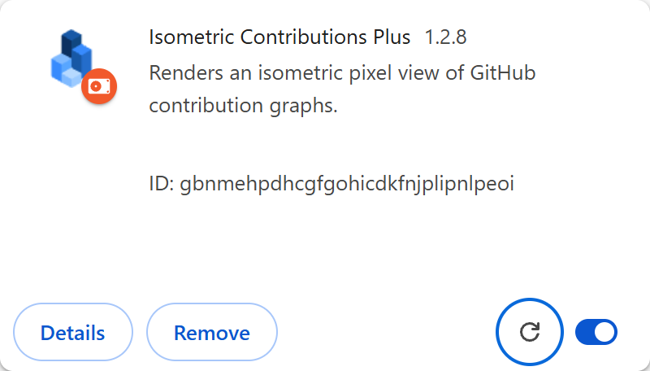
</picture>

共享配色位于 [`src/theme.css`](src/theme.css)。图标、截图的生成方法以及与颜色自定义、2D 缩放的集成约定，见 [`scripts/artwork/README.md`](scripts/artwork/README.md)。

## 相关项目

[Qiuner 的同名独立分支](https://github.com/Qiuner/isometric-contributions-plus) 包含 GitCode 集成等功能，与本仓库分别维护。

## 开源协议

本项目以 [MIT License](LICENSE) 协议开源，保留原始版权声明及第三方依赖许可。
