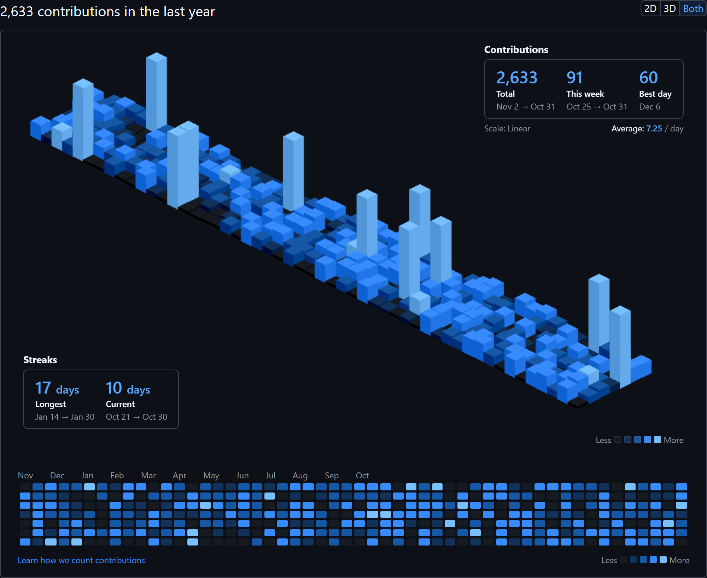
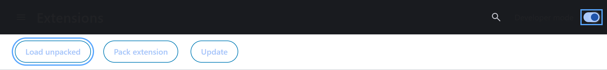
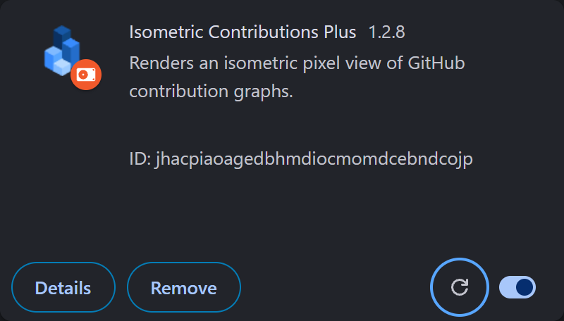

# Isometric Contributions extension

[](https://github.com/vycdev/isometric-contributions-plus/actions/workflows/nodejs.yml) [](LICENSE) [](https://www.patreon.com/cw/vycdev)

This is a browser extension for Chrome/Brave and Firefox that lets you toggle between your regular GitHub contribution chart and an isometric pixel art version. It uses [obelisk.js](https://github.com/nosir/obelisk.js) for the isometric graphics.

Besides being sort of neat looking, this view is interesting in that it highlights the differences between the number of contributions with more granularity. This isn't meant to completely replace the standard 2D graph though, because in most ways it is actually less useful. For example, there are no axis labels, shorter bars can be hidden behind taller ones, you can't hover over a bar to see the day and count, etc.




## Contribution scale

Click the extension's toolbar icon to open its settings menu. Under **Contribution scale**, choose how 3D bar heights and 2D color intensity represent daily contributions:

- **Linear** (default): height and color intensity are proportional to contribution counts.
- **Square root**: gives everyday activity a moderate boost while keeping peaks distinct. A gentler adjustment than logarithmic scaling, with less crowding from tall neighboring bars.
- **Logarithmic**: reduces the visual impact of unusually busy days so everyday activity is easier to see.

Open GitHub charts update immediately in 2D, 3D, and Both modes when you change the setting. The selected scale is displayed beside the daily average and beneath the 2D legend. Your choice is saved across profiles, years, and page reloads. All three scales keep inactive days neutral and flat, and the busiest visible day at maximum intensity and height. Square-root and logarithmic heights and intensities are not proportional to counts. Calendar square sizes, dates, counts, tooltips, totals, averages, and streaks stay unchanged.

The 2D colors interpolate through the current palette; legend swatches represent 0%, 25%, 50%, 75%, and 100% of the selected intensity scale. For a 609-contribution peak, a 10-contribution day has about 1.6% Linear, 12.8% Square root, or 37.4% Logarithmic intensity. Empty years stay neutral; a year with one contribution gives that day maximum intensity.

### Palette integration

`contributionIntensity` in `src/utils.js` owns the normalization shared by height and intensity. `src/calendar.js` samples the five unscaled `.ContributionCalendar-day[data-level="0".."4"]` fill colors, then interpolates between adjacent stops. Theme and configurable-palette changes should supply those fill colors (including a neutral level 0) and trigger the existing chart refresh after applying the palette. The intensity renderer writes only `--ic-intensity-color` on dated squares; it preserves `data-level` so original colors can still be sampled for 3D. The blue identity (#1) and color settings (#2) can integrate here without changing the normalization or adding another scale preference. The existing `heightScale` storage key is retained for compatibility.

## Installation

### Chrome/Brave

[Install from the Chrome Web Store](https://chrome.google.com/webstore/detail/isometric-contributions/mjoedlfflcchnleknnceiplgaeoegien?hl=en&gl=US)

### Firefox

[Install from Mozilla Add-ons site](https://addons.mozilla.org/en-US/firefox/addon/github-isometric-contributions/)

### Microsoft Edge

[Install from Microsoft Edge Add-ons site](https://microsoftedge.microsoft.com/addons/detail/github-isometric-contribu/hcicbpfcbdpfgibhlbphodkcbojakpej)

## Contributing

Use Node.js 22 or 24 (`.nvmrc` selects 22) and **pnpm 10.34.9**, pinned in
`package.json`. With a current [Corepack](https://pnpm.io/10.x/installation#using-corepack)
installation, run `corepack enable pnpm`; Corepack reads the project pin. If
Corepack is unavailable, bootstrap pnpm once with `npm install --global pnpm@10.34.9`.
Then run:

```sh
pnpm --version
pnpm install --frozen-lockfile
pnpm test
pnpm run build
```

On Windows, clone with `git -c core.autocrlf=false clone <repository-url>` so
checkout preserves the LF line endings expected by Biome. The Windows CI jobs
also preserve LF during checkout; existing CRLF checkouts may need their line
endings corrected before the full formatting check passes.

Commit `pnpm-lock.yaml` when dependencies change. It was imported from the npm
lockfile to retain existing resolutions. Dependabot intentionally uses its `npm`
ecosystem setting, which also supports pnpm's v9 lockfile. Overrides and install
script decisions live in `pnpm-workspace.yaml`. Parcel's native dependencies and
Puppeteer's browser download are approved there; new install scripts require an
explicit decision (`pnpm approve-builds`) before a clean install succeeds.

Useful contributor commands:

- `pnpm run start`: watch the extension during development.
- `pnpm run test:unit` / `pnpm run test:tooling`: run the unit or helper checks independently.
- `pnpm run test:e2e`: ensure Puppeteer's pinned Chrome is downloaded, build the extension, and run the live GitHub health check. The browser download is checked explicitly because a restored pnpm store can skip install scripts without restoring Puppeteer's separate cache.
- `pnpm run build:all`: create Chrome, Edge, and Firefox ZIPs in `artifacts/` using the local `web-ext` tool; no system `zip` command is required.
- `pnpm run build:safari --resources-only`: build and sync Safari resources on any platform.
- `pnpm run build:safari` / `pnpm run build:safari:release`: also build the macOS app (requires macOS and Xcode).
- `pnpm run version:get` / `pnpm run version:patch`: inspect or bump extension and Safari versions; minor, major, and `pnpm run version:set X.Y.Z` variants are also available.
- `pnpm run submit:chrome`, `pnpm run submit:edge`, `pnpm run submit:firefox`, and `pnpm run release`: publish using the configured store credentials.

Run script helpers through their `pnpm run` commands so child processes reuse
the pinned pnpm CLI on Windows, macOS, and Linux, including standalone pnpm
installations. Local tools use `pnpm exec` and do not download an unpinned CLI. `web-ext` is declared
directly because Firefox submission and ZIP packaging use its executable.
`pnpm run submit:dry-run` does not publish, but it requires store credentials and
contacts Google's token endpoint to validate them; it is not an offline check.

**_Note that I don't currently have any plans for adding new features to the extension. Please contact me before submitting a PR with new functionality._**

If you want to hack on the extension, you'll need to install it manually. First clone or fork this repo and install and build it with the commands above. Then, on your Chrome Extensions page, make sure "Developer mode" is checked. You can then click the "Load unpacked extension..." button and browse to the generated `dist` directory of this repo.



To hack on the extension, you'll first need to make sure you've installed it in Developer mode (see above). Once you've made changes to the extension, go back to the Extensions page and click the Reload link under the extension entry.



## Community Forks

- [isometric-contributions-plus](https://github.com/Qiuner/isometric-contributions-plus) - Extended version with GitCode integration and additional features

## License

This project is licensed under the [MIT License](http://opensource.org/licenses/MIT).
