# Isometric Contributions Plus

[](https://github.com/vycdev/isometric-contributions-plus/actions/workflows/nodejs.yml) [](LICENSE) [](https://www.patreon.com/cw/vycdev)

This is a browser extension for Chrome/Brave and Firefox that shows your GitHub contribution chart as isometric pixel art, as a line trend, or as GitHub's regular calendar, in any combination. It uses [obelisk.js](https://github.com/nosir/obelisk.js) for the isometric graphics.

This independent fork is maintained at [vycdev/isometric-contributions-plus](https://github.com/vycdev/isometric-contributions-plus), based on [Jason Long's Isometric Contributions](https://github.com/jasonlong/isometric-contributions). [中文说明](README-zh.md).

The extension uses blue by default across the 2D calendar, isometric graph, legends, statistics, and settings. Inactive days remain neutral. Light and dark palettes follow GitHub's appearance setting; the toolbar menu follows your system appearance.

Besides being sort of neat looking, this view is interesting in that it highlights the differences between the number of contributions with more granularity. This isn't meant to completely replace the standard 2D graph though, because in most ways it is actually less useful. For example, there are no axis labels, shorter bars can be hidden behind taller ones, you can't hover over a bar to see the day and count, etc.

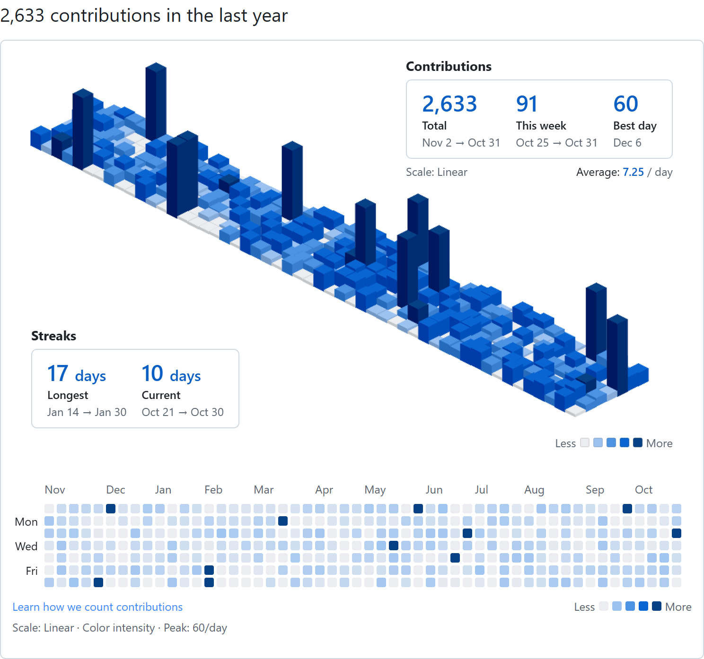

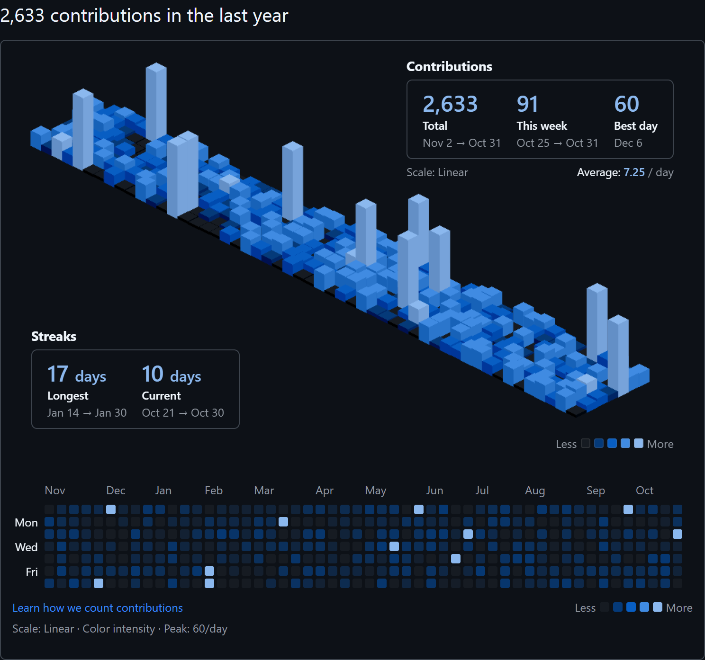

Screenshots use sample contribution data.

## Views

Click the extension's toolbar icon to open its settings menu. Under **Views**, turn on any combination of:

- **3D isometric** (default): the isometric cubes with totals, best day and streaks.
- **Line trend**: a 28-day average of your daily contributions, with the same dates a year earlier as a dashed line.
- **2D calendar**: GitHub's own calendar, colored by your contribution scale.

At least one view always stays on. Open GitHub profiles update immediately, and your choice is saved across profiles and reloads. If you used the earlier 2D / 3D / Both buttons, your choice carries over.

### Line trend

The line view answers questions the calendar can't: is your activity rising or falling, and are you more active than a year ago?

- **Activity** shows the 28-day average over faint daily bars. Your best day and longest streak in the period are marked. One unusually busy day is cut off at the top rather than flattening the rest of the chart.
- **Cumulative** shows your running total racing the year before's.
- Hover over the chart, or focus it and use the arrow keys, to read any day's count, average and the year-before value.
- Beneath the chart: your last 30 days compared with the 30 before, the period's total compared with the year before, and your most active weekday.

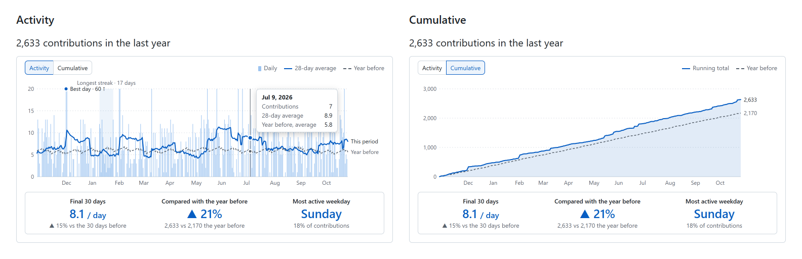

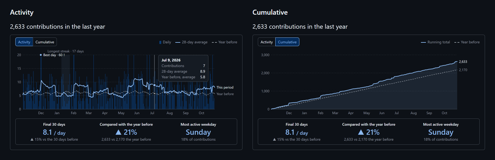

The comparison shifts dates back 52 weeks so weekdays line up. The year before is requested from GitHub only while the line view is on; completed years are kept for the rest of the page visit, and streaks reuse them. If it cannot load, the chart still shows your own trend. The line chart always uses linear values.

### Past year

Once you pick a year in GitHub's year list, GitHub offers no way back to its default view of the past 12 months. The extension adds a **Past year** entry at the top of the list that returns to it.

## Contribution scale

Click the extension's toolbar icon to open its settings menu. Under **Contribution scale**, choose how 3D bar heights and 2D color intensity represent daily contributions:

- **Linear** (default): height and color intensity are proportional to contribution counts.
- **Square root**: gives everyday activity a moderate boost while keeping peaks distinct. A gentler adjustment than logarithmic scaling, with less crowding from tall neighboring bars.
- **Logarithmic**: reduces the visual impact of unusually busy days so everyday activity is easier to see.

Open GitHub charts update immediately in every view when you change the setting. The selected scale is displayed beside the daily average and beneath the 2D legend. Your choice is saved across profiles, years, and page reloads. All three scales keep inactive days neutral and flat, and the busiest visible day at maximum intensity and height. Square-root and logarithmic heights and intensities are not proportional to counts. Calendar square sizes, dates, counts, tooltips, totals, averages, and streaks stay unchanged.

The 2D colors interpolate through the current palette; legend swatches represent 0%, 25%, 50%, 75%, and 100% of the selected intensity scale. For a 609-contribution peak, a 10-contribution day has about 1.6% Linear, 12.8% Square root, or 37.4% Logarithmic intensity. Empty years stay neutral; a year with one contribution gives that day maximum intensity.

### Palette integration

`contributionIntensity` in `src/utils.js` owns the normalization shared by height and intensity. The runtime supplies its five selected palette stops to `src/calendar.js`, which interpolates between adjacent stops; standalone callers can also sample the unscaled `.ContributionCalendar-day[data-level="0".."4"]` fills. The intensity renderer writes `--ic-intensity-color` on dated squares and preserves `data-level`. Cubes keep the original activity buckets while using the selected palette and height scale. Color and appearance changes refresh both views and their legends together. The existing `heightScale` storage key is retained for compatibility.

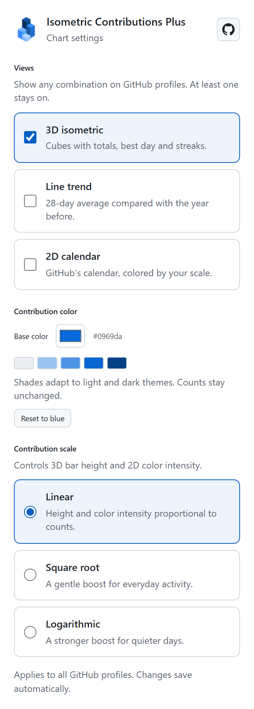
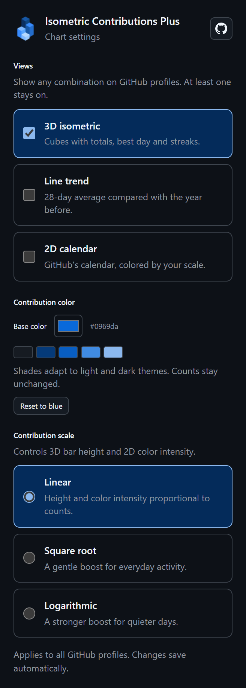

## Contribution color

Open the extension's toolbar menu and choose a **Contribution color**. Readable intensity shades are derived from that color for light and dark themes. The calendar, its legend, the isometric cubes, contribution statistics, Activity overview chart, Contribution activity bars, and view controls update together on open GitHub profiles. **Reset to blue** restores the default color (`#0969da`) without changing the height scale.

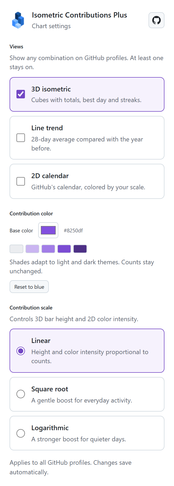
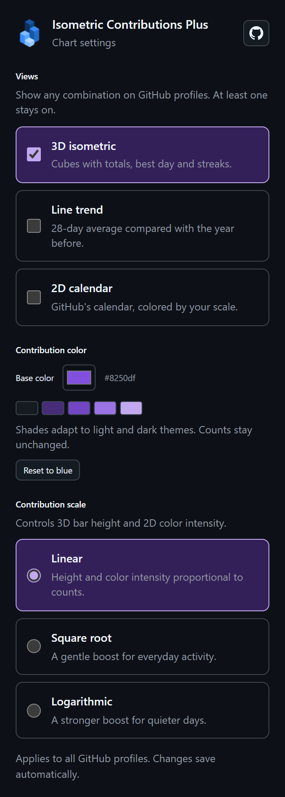

Your color is saved across profiles, selected years, and reloads. It works in every view with every height scale. Colors only change presentation: contribution counts, dates, tooltips, statistics, and GitHub's intensity buckets retain their original values.

The same sample chart in green (`#1a7f37`), purple (`#8250df`), and orange (`#e16f24`), in light and dark themes:

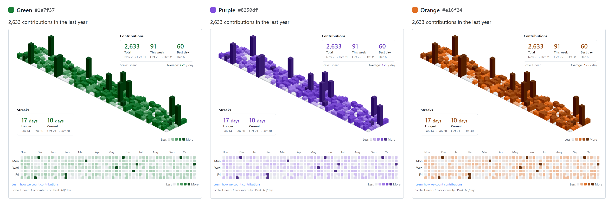

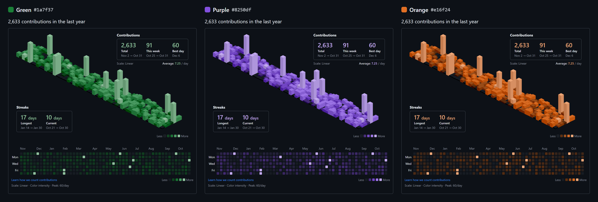

## Installation

**Plus has no verified Chrome, Firefox, Edge, or Safari store listing yet.** The original extension's store listings do not install this fork. Build locally until fork-owned listings are announced here. Any future packaged downloads belong on [this fork's Releases page](https://github.com/vycdev/isometric-contributions-plus/releases).

With Node.js 22 or 24 and pnpm 10.34.9 installed (see [Contributing](#contributing)):

```sh
git clone https://github.com/vycdev/isometric-contributions-plus.git
cd isometric-contributions-plus
pnpm install --frozen-lockfile
pnpm run build
```

- **Chrome/Brave/Edge:** open `chrome://extensions`, `brave://extensions`, or `edge://extensions`, enable Developer mode, choose **Load unpacked**, and select `dist/`.

  <picture>
    <source media="(prefers-color-scheme: dark)" srcset="img/dev-mode-dark.png" />
    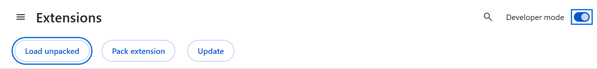
  </picture>

- **Firefox** (version 121 or later): run `pnpm run build:firefox`, then open `about:debugging#/runtime/this-firefox`, choose **Load Temporary Add-on**, and select `dist/manifest.json`. Temporary installations disappear when Firefox restarts. Packaging uses the local `web-ext` tool; no system `zip` command is required.
- **Safari:** `pnpm run build:safari --resources-only` generates the browser resources on any supported development platform. Building the native app requires macOS/Xcode; see [publishing configuration](PUBLISHING.md#safari).

Use the built `dist/` directory; source modules in `src/` need Parcel compilation. Reload the extension after rebuilding. The toolbar popup configures contribution scaling; this fork currently runs on `github.com`, without an Enterprise-domain enable menu.

## Contributing

Use Node.js 22 or 24 (`.nvmrc` selects 22) and **pnpm 10.34.9**, pinned in
`package.json`. With a current [Corepack](https://pnpm.io/10.x/installation#using-corepack)
installation, run `corepack enable pnpm`; Corepack reads the project pin. If
Corepack is unavailable, bootstrap pnpm once with `npm install --global pnpm@10.34.9`.
Then run:

```sh
pnpm --version
pnpm install --frozen-lockfile
pnpm test
pnpm run build
```

`.gitattributes` checks out text files with LF line endings on every platform,
whatever `core.autocrlf` says, so Biome's formatting check passes on Windows
too. To refresh a checkout made before it existed, commit or stash your work,
then run these from the repository root. Run the second only if the first
succeeds; it discards uncommitted changes.

```sh
git rm -r --cached -q .
git reset --hard
```

Commit `pnpm-lock.yaml` when dependencies change. It was imported from the npm
lockfile to retain existing resolutions. Dependabot intentionally uses its `npm`
ecosystem setting, which also supports pnpm's v9 lockfile. Overrides and install
script decisions live in `pnpm-workspace.yaml`. Parcel's native dependencies and
Puppeteer's browser download are approved there; new install scripts require an
explicit decision (`pnpm approve-builds`) before a clean install succeeds.

Useful contributor commands:

- `pnpm run start`: watch the extension during development.
- `pnpm run test:unit` / `pnpm run test:tooling` / `pnpm run test:publishing`: run unit, tooling, or fork publishing checks independently.
- `pnpm run test:e2e`: ensure Puppeteer's pinned Chrome is downloaded, build the extension, and run the live GitHub health check. The browser download is checked explicitly because a restored pnpm store can skip install scripts without restoring Puppeteer's separate cache.
- `pnpm run build:all`: create Chrome, Edge, and Firefox ZIPs in `artifacts/` using the local `web-ext` tool; no system `zip` command is required.
- `pnpm run build:safari --resources-only`: build and sync Safari resources on any platform.
- `pnpm run build:safari` / `pnpm run build:safari:release`: also build the macOS app (requires macOS and Xcode).
- `pnpm run version:get` / `pnpm run version:patch`: inspect or bump extension and Safari versions; minor, major, and `pnpm run version:set X.Y.Z` variants are also available.
- `pnpm run submit:chrome`, `pnpm run submit:edge`, `pnpm run submit:firefox`, and `pnpm run release`: publish using the configured store credentials.

Run script helpers through their `pnpm run` commands so child processes reuse
the pinned pnpm CLI on Windows, macOS, and Linux, including standalone pnpm
installations. Local tools use `pnpm exec` and do not download an unpinned CLI. `web-ext` is declared
directly because Firefox submission and ZIP packaging use its executable.
`pnpm run submit:dry-run` checks configuration and artifacts offline. It never
authenticates or uploads. See [PUBLISHING.md](PUBLISHING.md) before configuring store accounts.

Report bugs, ask support questions, and discuss contributions in [this fork's issues](https://github.com/vycdev/isometric-contributions-plus/issues). Use `pnpm run start` for watch mode, `pnpm run test:unit` for unit tests, and `pnpm test` for formatting, lint, and unit checks. Report security problems privately as described in [SECURITY.md](SECURITY.md). See [PUBLISHING.md](PUBLISHING.md) for pending store-account setup. Never use upstream publisher accounts for this fork.

After changes, rebuild, then click **Reload** under the extension entry. Refresh open GitHub pages to reload the content script.

<picture>
  <source media="(prefers-color-scheme: dark)" srcset="img/reload-link-dark.png" />
  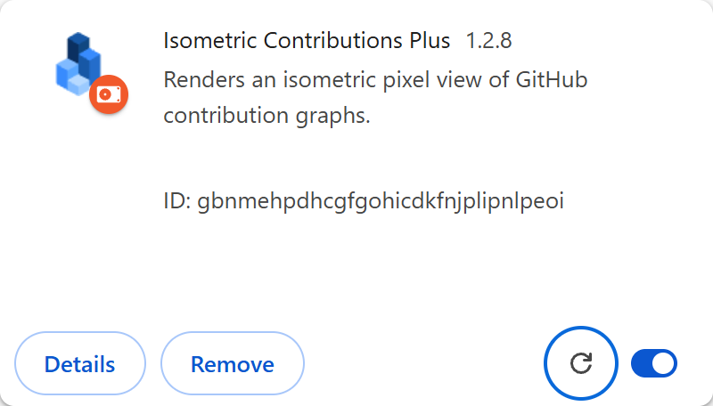
</picture>

### Theme and artwork

Shared light/dark palette tokens live in [`src/theme.css`](src/theme.css). See [`scripts/artwork/README.md`](scripts/artwork/README.md) for the color/scaling integration contract and the reproducible icon, screenshot, and visual-check workflow.

## Related projects

- [Qiuner's separate isometric-contributions-plus fork](https://github.com/Qiuner/isometric-contributions-plus) - GitCode integration and additional features; maintained independently of this repository.

## License

This project is licensed under the [MIT License](LICENSE). Original copyright and dependency notices are preserved.
